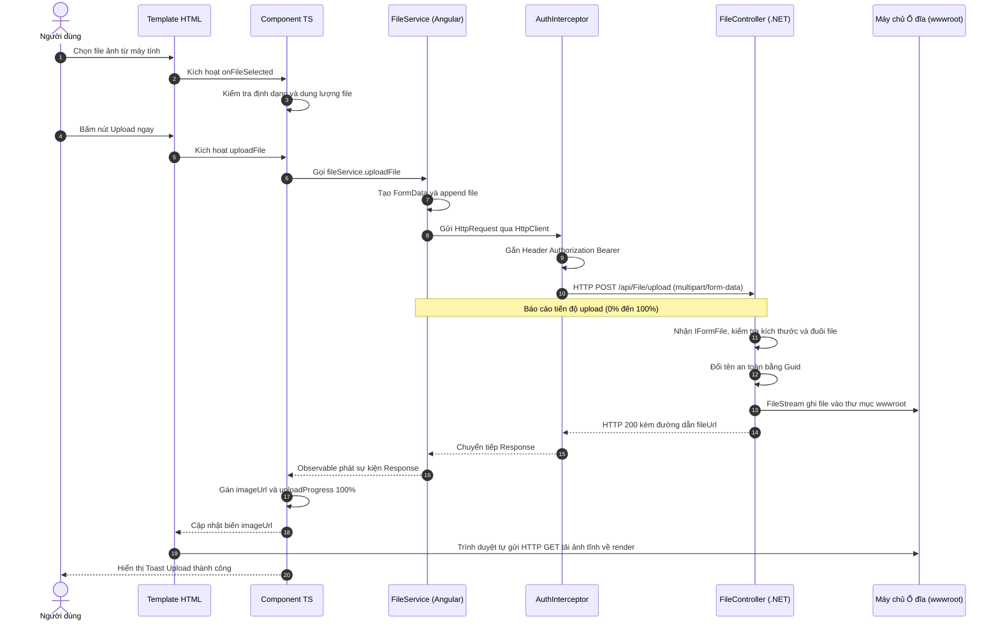
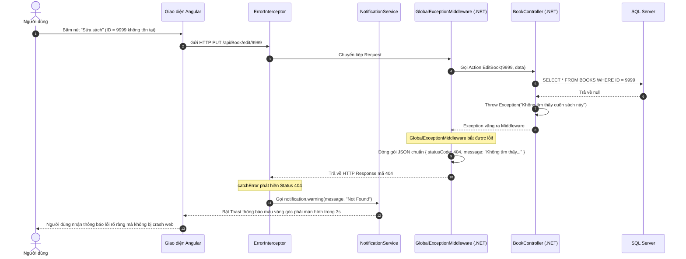
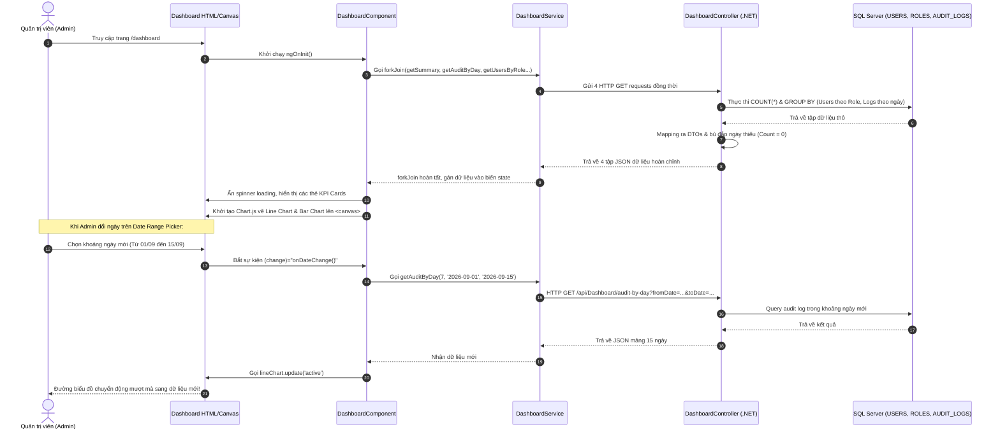

# TÀI LIỆU TOÀN DIỆN: GIẢI THÍCH KIẾN THỨC VÀ LUỒNG HOẠT ĐỘNG DỰ ÁN (TUẦN 3 & 4)
## (Hệ thống Quản lý Nhà sách: Angular + ASP.NET Core Web API + SQL Server)

---

## 📌 MỤC LỤC

1. [TỔNG QUAN KIẾN TRÚC VÀ VÒNG ĐỜI REQUEST - RESPONSE (END-TO-END OVERVIEW)](#1-tổng-quan-kiến-trúc-và-vòng-đời-request---response-end-to-end-overview)
2. [PHẦN 1: TÍNH NĂNG FILE UPLOAD & HIỂN THỊ ẢNH (FORM-DATA & STATIC FILES)](#phần-1-tính-năng-file-upload--hiển-thị-ảnh-form-data--static-files)
   - [1.1. Kiến thức cốt lõi từ số 0](#11-kiến-thức-cốt-lõi-từ-số-0)
   - [1.2. Phân tích chi tiết từng tầng (HTML ➔ TS ➔ Service ➔ API ➔ Lưu file ➔ Render)](#12-phân-tích-chi-tiết-từng-tầng-html--ts--service--api--lưu-file--render)
   - [1.3. Cơ chế `app.UseStaticFiles()` phân phối ảnh tĩnh](#13-cơ-chế-appusestaticfiles-phân-phối-ảnh-tĩnh)
   - [1.4. Sơ đồ tuần tự chi tiết luồng Request - Response](#14-sơ-đồ-tuần-tự-chi-tiết-luồng-request---response)
3. [PHẦN 2: GLOBAL EXCEPTION HANDLING & NOTIFICATION (BẮT LỖI TẬP TRUNG & TOAST)](#phần-2-global-exception-handling--notification-bắt-lỗi-tập-trung--toast)
   - [2.1. Tại sao cần bắt lỗi tập trung?](#21-tại-sao-cần-bắt-lỗi-tập-trung)
   - [2.2. Backend: Middleware xử lý ngoại lệ toàn cục (`GlobalExceptionMiddleware`)](#22-backend-middleware-xử-lý-ngoại-lệ-toàn-cục-globalexceptionmiddleware)
   - [2.3. Frontend: HttpInterceptor bắt mã lỗi (`ErrorInterceptor`)](#23-frontend-httpinterceptor-bắt-mã-lỗi-errorinterceptor)
   - [2.4. Dịch vụ Toast Notification (`ngx-toastr`)](#24-dịch-vụ-toast-notification-ngx-toastr)
   - [2.5. Sơ đồ tuần tự chi tiết khi xảy ra lỗi (Error Flow)](#25-sơ-đồ-tuần-tự-chi-tiết-khi-xảy-ra-lỗi-error-flow)
4. [PHẦN 3: BÁO CÁO THỐNG KÊ DASHBOARD & TRỰC QUAN HÓA BIỂU ĐỒ (CHART.JS)](#phần-3-báo-cáo-thống-kê-dashboard--trực-quan-hóa-biểu-đồ-chartjs)
   - [3.1. Phân tích bài toán tổng hợp dữ liệu](#31-phân-tích-bài-toán-tổng-hợp-dữ-liệu)
   - [3.2. Backend: Truy vấn EF Core, LINQ & Xử lý Left-Join dải ngày](#32-backend-truy-vấn-ef-core-linq--xử-lý-left-join-dải-ngày)
   - [3.3. Frontend: RxJS `forkJoin`, Canvas HTML5 & Tích hợp Chart.js](#33-frontend-rxjs-forkjoin-canvas-html5--tích-hợp-chartjs)
   - [3.4. Nâng cấp Date Range Picker với chuyển động mượt mà (In-Place Update)](#34-nâng-cấp-date-range-picker-với-chuyển-động-mượt-mà-in-place-update)
   - [3.5. Sơ đồ tuần tự chi tiết luồng thống kê Dashboard](#35-sơ-đồ-tuần-tự-chi-tiết-luồng-thống-kê-dashboard)
5. [PHẦN 4: HỆ THỐNG LƯU VẾT HOẠT ĐỘNG (AUDIT LOGGING QUA ACTION FILTER)](#phần-4-hệ-thống-lưu-vết-hoạt-động-audit-logging-qua-action-filter)
   - [4.1. Cơ chế tự động bắt vết bằng `IAsyncActionFilter`](#41-cơ-chế-tự-động-bắt-vết-bằng-iasyncactionfilter)
   - [4.2. Trích xuất Claims từ JWT và ghi nhận vào Database](#42-trích-xuất-claims-từ-jwt-và-ghi-nhận-vào-database)
6. [TỔNG KẾT BẢNG MAPPING TOÀN HỆ THỐNG](#tổng-kết-bảng-mapping-toàn-hệ-thống)

---

# 1. TỔNG QUAN KIẾN TRÚC VÀ VÒNG ĐỜI REQUEST - RESPONSE (END-TO-END OVERVIEW)

Mỗi tương tác của người dùng trong hệ thống đều trải qua một chu trình khép kín 3 tầng (Frontend ➔ Backend ➔ Database ➔ Frontend):

```
┌────────────────────────────────────────────────────────────────────────────────────────────────┐
│ 1. FRONTEND (ANGULAR)                                                                          │
│  [HTML Template] ──(Event/Binding)──> [Component TS] ──> [Service] ──> [HttpInterceptor]      │
└─────────────────────────────────────────────┬──────────────────────────────────────────────────┘
                                              │ HTTP Request (Headers + JWT Bearer + Body)
                                              ▼
┌────────────────────────────────────────────────────────────────────────────────────────────────┐
│ 2. BACKEND (ASP.NET CORE WEB API)                                                             │
│  [Middleware Pipeline] (CORS ➔ JWT Auth ➔ GlobalExceptionMW)                                  │
│         │                                                                                      │
│         ▼                                                                                      │
│  [Routing & Model Binding] ──> [Action Filter (AuditLog)] ──> [API Controller Action]          │
│                                                                      │                         │
│                                                                      ▼                         │
│                                                          [EF Core ApplicationDbContext]        │
└─────────────────────────────────────────────┬────────────────────────┴─────────────────────────┘
                                              │ T-SQL (SELECT / INSERT / UPDATE / GROUP BY)
                                              ▼
┌────────────────────────────────────────────────────────────────────────────────────────────────┐
│ 3. DATABASE (SQL SERVER)                                                                       │
│  [Bảng USERS, ROLES, ACCOUNTS, BOOKS, CATEGORIES, AUDIT_LOGS]                                  │
└────────────────────────────────────────────────────────────────────────────────────────────────┘
```

---

# PHẦN 1: TÍNH NĂNG FILE UPLOAD & HIỂN THỊ ẢNH (FORM-DATA & STATIC FILES)

## 1.1. Kiến thức cốt lõi từ số 0
- **Dữ liệu nhị phân (Binary Data):** File ảnh (`.jpg`, `.png`, `.webp`) là các dãy byte nhị phân. Nếu gửi qua JSON thông thường (Base64), dung lượng sẽ tăng thêm 33% và tốn bộ nhớ CPU để encode/decode.
- **`multipart/form-data` & `FormData`:** Chuẩn HTTP cho phép đóng gói dữ liệu nhị phân nguyên bản vào từng phần (part) có ranh giới phân tách (boundary), truyền tải tối ưu qua mạng.
- **Static Files:** Các tệp vật lý lưu trên ổ đĩa máy chủ không thể tự động truy cập nếu server không cấu hình Middleware phục vụ file tĩnh.

---

## 1.2. Phân tích chi tiết từng tầng (HTML ➔ TS ➔ Service ➔ API ➔ Lưu file ➔ Render)

### 🔹 Bước 1: Giao diện HTML ([file-upload-page.component.html](file:///d:/Thuc%20Tap/Angular%20Tutorial/Management_Bookstore_Online/ManagementBTOnline/Frontend/src/app/UI/Page/file-upload_page/file-upload-page.component.html))
- Thẻ `<input type="file" (change)="onFileSelected($event)" accept="image/*">`:
  - Người dùng bấm nút "Chọn ảnh", hộp thoại máy tính mở ra.
  - Khi người dùng chọn 1 file, sự kiện `(change)` phát sinh, truyền đối tượng `$event` chứa danh sách file đã chọn vào hàm TypeScript.

### 🔹 Bước 2: Xử lý logic tại Component TypeScript ([file-upload-page.component.ts](file:///d:/Thuc%20Tap/Angular%20Tutorial/Management_Bookstore_Online/ManagementBTOnline/Frontend/src/app/UI/Page/file-upload_page/file-upload-page.component.ts))
1. **Kiểm tra hợp lệ Client-side:**
   - Lấy file: `const file: File = event.target.files[0];`.
   - Kiểm tra định dạng: `['image/jpeg', 'image/png', 'image/webp'].includes(file.type)`. Nếu sai, gọi `notification.error(...)` và dừng.
   - Kiểm tra kích thước: `file.size > 10MB` -> Báo lỗi ngay lập tức mà không cần gửi lên Server.
2. **Kích hoạt gửi file:**
   - Đặt cờ `this.isUploading = true;`.
   - Gọi `this.fileService.uploadFile(this.selectedFile)`.

### 🔹 Bước 3: Đóng gói và gửi tại Service ([file.service.ts](file:///d:/Thuc%20Tap/Angular%20Tutorial/Management_Bookstore_Online/ManagementBTOnline/Frontend/src/app/services/FileService/file.service.ts))
```typescript
uploadFile(file: File) {
  const formData = new FormData();
  formData.append('file', file); // Tên field 'file' khớp với tham số IFormFile trên C#

  return this.http.post<UploadResponse>(
    `${this.apiUrl}/upload`,
    formData,
    {
      reportProgress: true, // Yêu cầu theo dõi tiến trình
      observe: 'events'     // Lắng nghe từng gói tin trả về
    }
  );
}
```

### 🔹 Bước 4: Chuyển tiếp qua HttpInterceptor ([auth.interceptor.ts](file:///d:/Thuc%20Tap/Angular%20Tutorial/Management_Bookstore_Online/ManagementBTOnline/Frontend/src/app/interceptors/auth.interceptor.ts))
- Interceptor tự động đọc JWT Token từ `localStorage` và đính kèm Header:
  `Authorization: Bearer eyJhbGciOi...` vào request.

### 🔹 Bước 5: Tiếp nhận và xử lý tại Backend ([FileController.cs](file:///d:/Thuc%20Tap/Angular%20Tutorial/Management_Bookstore_Online/ManagementBTOnline/Backend/ManagementBTOnline_API/Controllers/FileController.cs))
1. **Tiếp nhận tham số:** `public async Task<IActionResult> Upload(IFormFile file)`.
2. **Kiểm tra hợp lệ Server-side:**
   - `file.Length == 0` hoặc `file.Length > 10MB` ➔ `BadRequest()`.
   - `Path.GetExtension(file.FileName)` có nằm trong `[".jpg", ".jpeg", ".png", ".webp"]` không.
3. **Sinh tên file an toàn (Chống trùng lặp & Chống tấn công Path Traversal):**
   - Tạo tên duy nhất bằng GUID: `var fileName = Guid.NewGuid() + extension;`.
4. **Lưu vật lý vào đĩa cứng:**
   ```csharp
   var uploadFolder = Path.Combine(_enviroment.WebRootPath, "uploads", "images");
   if (!Directory.Exists(uploadFolder)) Directory.CreateDirectory(uploadFolder);
   var filePath = Path.Combine(uploadFolder, fileName);
   using var stream = new FileStream(filePath, FileMode.Create);
   await file.CopyToAsync(stream);
   ```
5. **Tạo URL công khai và trả phản hồi:**
   ```csharp
   var fileUrl = $"{Request.Scheme}://{Request.Host}/uploads/images/{fileName}";
   return Ok(new { message = "Upload thành công", fileName, fileUrl });
   ```

### 🔹 Bước 6: Nhận kết quả và Render lại giao diện
1. Component nhận `event.type === HttpEventType.UploadProgress`: Tính toán `this.uploadProgress = Math.round((loaded / total) * 100);` ➔ Thanh progress bar trên HTML tự động chạy từ 0% đến 100%.
2. Component nhận `event.type === HttpEventType.Response`:
   - Gán `this.imageUrl = event.body.fileUrl;`.
   - HTML binding: ``.
   - Trình duyệt tự động gửi GET request tải ảnh từ static URL về hiển thị lên giao diện.

---

## 1.3. Cơ chế `app.UseStaticFiles()` phân phối ảnh tĩnh

Tại [Program.cs](file:///d:/Thuc%20Tap/Angular%20Tutorial/Management_Bookstore_Online/ManagementBTOnline/Backend/ManagementBTOnline_API/Program.cs#L94):
```csharp
app.UseStaticFiles();
```
- Khi Angular gán URL `https://localhost:7185/uploads/images/abc.jpg` vào thẻ ``:
  - Request đi vào Middleware Pipeline của .NET.
  - `StaticFileMiddleware` chặn request lại, so khớp đường dẫn `/uploads/images/abc.jpg` với thư mục vật lý `wwwroot/uploads/images/abc.jpg`.
  - Nếu file tồn tại, middleware đọc file nhị phân từ đĩa cứng, gắn Header `Content-Type: image/jpeg` và stream về trình duyệt mà không cần chạy qua bất kỳ Controller nào.

---

## 1.4. Sơ đồ tuần tự chi tiết luồng Request - Response



---

# PHẦN 2: GLOBAL EXCEPTION HANDLING & NOTIFICATION (BẮT LỖI TẬP TRUNG & TOAST)

## 2.1. Tại sao cần bắt lỗi tập trung?
- **Nhược điểm của cách cũ:** Viết `try-catch` lặp đi lặp lại ở mọi Controller và mọi hàm trong Angular; dễ để lộ thông tin nhạy cảm của CSDL khi hệ thống bị crash.
- **Mục tiêu:** Bất kỳ lỗi nào (Lỗi nghiệp vụ, Lỗi Server 500, Lỗi phân quyền 401/403, Lỗi sai dữ liệu 400) đều được bắt tại một nơi duy nhất, chuyển đổi thành mã JSON chuẩn và hiển thị Toast trực quan cho người dùng.

---

## 2.2. Backend: Middleware xử lý ngoại lệ toàn cục (`GlobalExceptionMiddleware`)

File nguồn: [GlobalExceptionMiddleware.cs](file:///d:/Thuc%20Tap/Angular%20Tutorial/Management_Bookstore_Online/ManagementBTOnline/Backend/ManagementBTOnline_API/Middleware/GlobalExceptionMiddleware.cs)

### Cơ chế hoạt động:
1. Nằm ở tầng ngoài cùng của HTTP Pipeline trong [Program.cs](file:///d:/Thuc%20Tap/Angular%20Tutorial/Management_Bookstore_Online/ManagementBTOnline/Backend/ManagementBTOnline_API/Program.cs#L98): `app.UseMiddleware<GlobalExceptionMiddleware>();`.
2. Khi một Action trong Controller ném Exception (ví dụ: `throw new Exception("Sách không tồn tại")`):
   - Luồng thực thi bị ngắt, Exception văng ngược ra ngoài Pipeline.
   - Hàm `InvokeAsync()` bắt trọn bằng khối `catch (Exception ex)`.
3. Hàm `HandleExceptionAsync` ghi đè response với cấu trúc JSON đồng nhất:
   ```json
   {
     "statusCode": 500,
     "message": "Đã xảy ra lỗi trên server.",
     "error": "Internal Server Error",
     "timestamp": "2026-09-24T18:30:00Z"
   }
   ```

---

## 2.3. Frontend: HttpInterceptor bắt mã lỗi (`ErrorInterceptor`)

File nguồn: [error.interceptor.ts](file:///d:/Thuc%20Tap/Angular%20Tutorial/Management_Bookstore_Online/ManagementBTOnline/Frontend/src/app/interceptors/error.interceptor.ts)

- Sử dụng toán tử RxJS `catchError((error: HttpErrorResponse) => ...)`:
  - **400 Bad Request:** Đọc `error.error.message` và bật Toast báo dữ liệu không hợp lệ.
  - **401 Unauthorized:** Xóa token trong `localStorage`, thông báo hết phiên và điều hướng về `/login`.
  - **403 Forbidden:** Bật Toast "Bạn không có quyền thực hiện thao tác này".
  - **404 Not Found:** Bật Toast "Không tìm thấy dữ liệu".
  - **500 Server Error:** Bật Toast "Lỗi máy chủ nội bộ, vui lòng thử lại sau".

---

## 2.4. Dịch vụ Toast Notification (`ngx-toastr`)

File nguồn: [notification.service.ts](file:///d:/Thuc%20Tap/Angular%20Tutorial/Management_Bookstore_Online/ManagementBTOnline/Frontend/src/app/services/NotificationService/notification.service.ts)
- Thay thế hoàn toàn hàm `alert()` gây gián đoạn luồng người dùng.
- Hiển thị thông báo dạng thẻ nổi ở góc trên bên phải màn hình, có icon và màu sắc quy chuẩn, tự động mờ dần và biến mất sau 3 giây.

---

## 2.5. Sơ đồ tuần tự chi tiết khi xảy ra lỗi (Error Flow)



---

# PHẦN 3: BÁO CÁO THỐNG KÊ DASHBOARD & TRỰC QUAN HÓA BIỂU ĐỒ (CHART.JS)

## 3.1. Phân tích bài toán tổng hợp dữ liệu
- Người quản trị cần xem:
  1. **Thẻ tóm tắt số liệu (KPI Cards):** Tổng sách, tổng danh mục, tổng người dùng, tổng tài khoản, tổng audit log.
  2. **Biểu đồ cột (Bar Chart):** Phân bổ số lượng người dùng theo từng vai trò (`ADMIN`, `STAFF`, `CUSTOMER`).
  3. **Biểu đồ đường (Line Chart):** Xu hướng thao tác hệ thống (Audit Log) theo từng ngày.
  4. **Bộ lọc khoảng ngày (Date Range Picker):** Cho phép người dùng chọn "Từ ngày" đến "Đến ngày" để xem lại dữ liệu lịch sử bất kỳ lúc nào.

---

## 3.2. Backend: Truy vấn EF Core, LINQ & Xử lý Left-Join dải ngày

File nguồn: [DashboardController.cs](file:///d:/Thuc%20Tap/Angular%20Tutorial/Management_Bookstore_Online/ManagementBTOnline/Backend/ManagementBTOnline_API/Controllers/DashboardController.cs)

### A. Kỹ thuật Left-Join dải ngày tránh đứt đoạn biểu đồ:
- Nếu chỉ truy vấn `GroupBy(CreatedAt.Date)` trong DB, những ngày **không có ai thao tác sẽ không xuất hiện trong kết quả SQL**. Nếu vẽ lên Line Chart, trục hoành sẽ bị nhảy cóc ngày.
- **Giải pháp:**
  1. Dùng C# sinh toàn bộ dải ngày từ `start` đến `end`: `Enumerable.Range(0, totalDays).Select(i => start.AddDays(i))`.
  2. Truy vấn DB lấy các ngày có log.
  3. Dùng LINQ kết hợp (Left-Join): Nếu ngày nào không có log thì gán `Count = 0`. Trục hoành của Line Chart luôn liên tục và chính xác.

---

## 3.3. Frontend: RxJS `forkJoin`, Canvas HTML5 & Tích hợp Chart.js

File nguồn: [dashboard-page.component.ts](file:///d:/Thuc%20Tap/Angular%20Tutorial/Management_Bookstore_Online/ManagementBTOnline/Frontend/src/app/UI/Page/dashboard/dashboard-page.component.ts)

### A. Tải song song 4 API với `forkJoin`:
```typescript
forkJoin({
  summary:         this.dashboardService.getSummary(),
  auditByDay:      this.dashboardService.getAuditByDay(7, this.fromDate, this.toDate),
  booksByCategory: this.dashboardService.getBooksByCategory(),
  usersByRole:     this.dashboardService.getUsersByRole()
}).subscribe(results => {
  this.summary = results.summary;
  this.auditByDay = results.auditByDay;
  this.usersByRole = results.usersByRole;
  this.isLoading = false;
  this.renderCharts();
});
```

### B. Vẽ biểu đồ lên thẻ `<canvas>`:
- **Bar Chart (Users by Role):** Cột màu đỏ cho Admin, xanh dương cho Staff, xanh lá cho Customer, bo góc cột `borderRadius: 8`, hiệu ứng nảy cột `easeOutBounce`.
- **Line Chart (Audit Log theo ngày):** Đường cong mềm `tension: 0.4`, phủ màu Gradient mờ Indigo phía dưới, hiển thị tooltip số lượt thao tác khi hover chuột.

---

## 3.4. Nâng cấp Date Range Picker với chuyển động mượt mà (In-Place Update)

### A. Ràng buộc ngày trên Template HTML:
```html
<input type="date" [(ngModel)]="fromDate" [max]="toDate" (change)="onDateChange()">
<input type="date" [(ngModel)]="toDate" [min]="fromDate" (change)="onDateChange()">
```

### B. Cập nhật In-Place (Không Destroy Chart):
- Khi người dùng đổi ngày, ta **không gọi `destroy()` rồi tạo lại** (gây chớp nháy UI).
- Ta chỉ cập nhật dữ liệu vào instance Chart hiện có và kích hoạt animation:
  ```typescript
  this.lineChart.data.labels           = this.auditByDay.map(d => d.date);
  this.lineChart.data.datasets[0].data = this.auditByDay.map(d => d.count);
  this.lineChart.update('active'); // Chart.js tự động nội suy chuyển động các điểm nút mượt mà
  ```

---

## 3.5. Sơ đồ tuần tự chi tiết luồng thống kê Dashboard



---

# PHẦN 4: HỆ THỐNG LƯU VẾT HOẠT ĐỘNG (AUDIT LOGGING QUA ACTION FILTER)

File nguồn: [AuditLogFilter.cs](file:///d:/Thuc%20Tap/Angular%20Tutorial/Management_Bookstore_Online/ManagementBTOnline/Backend/ManagementBTOnline_API/Models/AuditLogManagementl/AuditLogFilter.cs)

## 4.1. Cơ chế tự động bắt vết bằng `IAsyncActionFilter`
- Thay vì chèn code ghi log thủ công ở từng hàm thêm/sửa/xóa, hệ thống sử dụng **Action Filter**.
- `AuditLogFilter` tự động chặn trước và sau khi Action thực thi:
  1. Chỉ ghi log khi HTTP Method là `POST`, `PUT`, `DELETE` (bỏ qua `GET`).
  2. Bỏ qua các API xác thực (Login/Register).
  3. Chỉ ghi khi thao tác thành công (StatusCode từ 200 đến 299).

## 4.2. Trích xuất Claims từ JWT và ghi nhận vào Database
```csharp
string userName = httpContext.User.FindFirst(ClaimTypes.Name)?.Value ?? "Unknown";
string action = method switch {
    "POST" => "CREATE",
    "PUT"  => "UPDATE",
    "DELETE" => "DELETE",
    _ => method
};

var auditLog = new AuditLogModel {
    UserId = userId,
    UserName = userName,
    Action = action,
    ControllerName = controllerName,
    ActionName = actionName,
    Description = $"{action} dữ liệu tại {controllerName}/{actionName}",
    CreatedAt = DateTime.Now
};

_context.AuditLogs.Add(auditLog);
await _context.SaveChangesAsync();
```

---

# TỔNG KẾT BẢNG MAPPING TOÀN HỆ THỐNG

| Tính năng | Frontend (Angular) | Backend (.NET Web API) | Database (SQL Server) |
| :--- | :--- | :--- | :--- |
| **File Upload** | `HTML input file` ➔ `FormData` ➔ `reportProgress` ➔ Gán `[src]` | `IFormFile` ➔ Đổi tên `Guid` ➔ Lưu `wwwroot/uploads` ➔ `app.UseStaticFiles()` | Lưu đường dẫn ảnh vào cột `BOOK_IMAGE` bảng `BOOKS` |
| **Global Exception** | `ErrorInterceptor` bắt 400, 401, 403, 404, 500 ➔ `NotificationService (Toastr)` | `GlobalExceptionMiddleware` bắt `try-catch` toàn cục ➔ Chuẩn hóa `ErrorResponseModel` | Bảo vệ toàn vẹn dữ liệu, che giấu lỗi SQL Server |
| **Dashboard Analytics** | RxJS `forkJoin` ➔ `Chart.js` (Line & Bar) ➔ Date Range Picker `[(ngModel)]` | `DashboardController` ➔ LINQ `CountAsync()`, `GroupBy()` ➔ Left-Join dải ngày | Thực thi câu lệnh `SELECT COUNT(*)` tối ưu với Index |
| **Audit Logging** | Trang Lịch sử hoạt động (`audit-log-page`) hiển thị bảng dữ liệu | `AuditLogFilter (IAsyncActionFilter)` tự động trích xuất Claims từ JWT | Bảng `AUDIT_LOGS` lưu lại: Ai làm, Thao tác gì, Thời gian nào |
