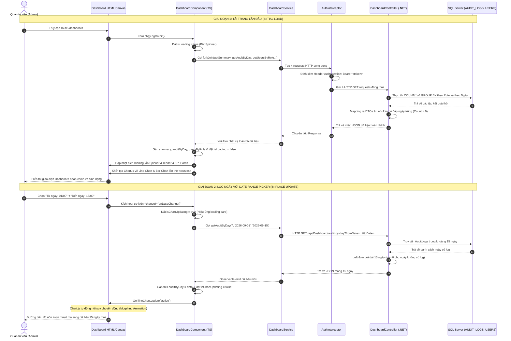

# TÀI LIỆU TOÀN DIỆN: GIẢI THÍCH KIẾN THỨC VÀ LUỒNG HOẠT ĐỘNG DỰ ÁN (TUẦN 5 & 6)
## (Báo cáo Thống kê Dashboard, Trực quan hóa Biểu đồ Chart.js & Date Range Picker)

---

## 📌 MỤC LỤC

1. [TỔNG QUAN KIẾN TRÚC VÀ VÒNG ĐỜI REQUEST - RESPONSE (DASHBOARD ARCHITECTURE)](#1-tổng-quan-kiến-trúc-và-vòng-đời-request---response-dashboard-architecture)
2. [PHẦN 1: KIẾN THỨC NỀN TẢNG VỀ BIỂU ĐỒ (CHART.JS & HTML5 CANVAS)](#phần-1-kiến-thức-nền-tảng-về-biểu-đồ-chartjs--html5-canvas)
   - [1.1. Bản chất đồ họa Canvas 2D Bitmap trong HTML5](#11-bản-chất-đồ-họa-canvas-2d-bitmap-trong-html5)
   - [1.2. Giải pháp nhúng Chart.js qua CDN tối ưu hiệu năng](#12-giải-pháp-nhúng-chartjs-qua-cdn-tối-ưu-hiệu-năng)
   - [1.3. Cơ chế đồng bộ Vòng đời Angular (Lifecycle Hooks & View Synchronization)](#13-cơ-chế-đồng-bộ-vòng-đời-angular-lifecycle-hooks--view-synchronization)
   - [1.4. Quản lý dọn dẹp RAM và chống rò rỉ bộ nhớ (Memory Leak)](#14-quản-lý-dọn-dẹp-ram-và-chống-rò-rỉ-bộ-nhớ-memory-leak)
3. [PHẦN 2: CHI TIẾT CÁC LUỒNG HOẠT ĐỘNG TỪNG TẦNG (HTML ➔ TS ➔ API ➔ DB ➔ RESPONSE)](#phần-2-chi-tiết-các-luồng-hoạt-động-từng-tầng-html--ts--api--db--response)
   - [2.1. LUỒNG 1: Tải toàn bộ dữ liệu Dashboard khi mở trang (RxJS `forkJoin`)](#21-luồng-1-tải-toàn-bộ-dữ-liệu-dashboard-khi-mở-trang-rxjs-forkjoin)
   - [2.2. LUỒNG 2: Biểu đồ đường (Line Chart) theo dõi Audit Log theo thời gian](#22-luồng-2-biểu-đồ-đường-line-chart-theo-dõi-audit-log-theo-thời-gian)
   - [2.3. LUỒNG 3: Biểu đồ cột (Bar Chart) phân tích cơ cấu User theo Role](#23-luồng-3-biểu-đồ-cột-bar-chart-phân-tích-cơ-cấu-user-theo-role)
   - [2.4. LUỒNG 4: Nâng cấp Date Range Picker với chuyển động mượt mà (In-Place Update)](#24-luồng-4-nâng-cấp-date-range-picker-với-chuyển-động-mượt-mà-in-place-update)
4. [PHẦN 3: SƠ ĐỒ TUẦN TỰ TOÀN DIỆN (END-TO-END SEQUENCE DIAGRAMS)](#phần-3-sơ-đồ-tuần-tự-toàn-diện-end-to-end-sequence-diagrams)
5. [TỔNG KẾT BẢNG SO SÁNH VÀ ĐẶC TẢ KỸ THUẬT](#tổng-kết-bảng-so-sánh-và-đặc-tả-kỹ-thuật)

---

# 1. TỔNG QUAN KIẾN TRÚC VÀ VÒNG ĐỜI REQUEST - RESPONSE (DASHBOARD ARCHITECTURE)

Hệ thống báo cáo Dashboard được thiết kế theo mô hình bất đồng bộ hoàn toàn (Full Async Architecture), xử lý đồng thời nhiều luồng dữ liệu song song:

```
┌───────────────────────────────────────────────────────────────────────────────────────────────────┐
│ 1. TẦNG CLIENT (ANGULAR 16 SPA)                                                                   │
│  [dashboard-page.html] ◄──(Two-way Binding)──► [dashboard-page.ts]                                │
│       │                                             │                                             │
│  (Thẻ <canvas>)                               (RxJS forkJoin)                                     │
│       ▲                                             │                                             │
│       │ (Vẽ biểu đồ / In-place update)              ▼                                             │
│  [Chart.js 3.9 CDN]                      [DashboardService] ──> [Auth/Error Interceptors]         │
└─────────────────────────────────────────────────────┬─────────────────────────────────────────────┘
                                                      │ HTTP GET Requests + Header Bearer Token
                                                      ▼
┌───────────────────────────────────────────────────────────────────────────────────────────────────┐
│ 2. TẦNG SERVER (.NET WEB API)                                                                     │
│  [Middleware Pipeline: CORS ➔ JWT Authentication ➔ GlobalExceptionMiddleware]                    │
│                                                     │                                             │
│                                                     ▼                                             │
│                 [DashboardController: [Authorize(Roles = "ADMIN")]]                               │
│                   ├── GET /api/Dashboard/summary                                                  │
│                   ├── GET /api/Dashboard/audit-by-day?fromDate=...&toDate=...                    │
│                   ├── GET /api/Dashboard/users-by-role                                            │
│                   └── GET /api/Dashboard/books-by-category                                        │
│                                                     │                                             │
│                                                     ▼                                             │
│                                    [ApplicationDBContext (EF Core)]                               │
└─────────────────────────────────────────────────────┬─────────────────────────────────────────────┘
                                                      │ T-SQL: SELECT COUNT(*), GROUP BY
                                                      ▼
┌───────────────────────────────────────────────────────────────────────────────────────────────────┐
│ 3. TẦNG CƠ SỞ DỮ LIỆU (SQL SERVER)                                                                │
│  [Bảng AUDIT_LOGS, USERS, ROLES, BOOKS, CATEGORIES, ACCOUNTS]                                     │
└───────────────────────────────────────────────────────────────────────────────────────────────────┘
```

---

# PHẦN 1: KIẾN THỨC NỀN TẢNG VỀ BIỂU ĐỒ (CHART.JS & HTML5 CANVAS)

## 1.1. Bản chất đồ họa Canvas 2D Bitmap trong HTML5
- Thẻ `<canvas id="myChart"></canvas>` là một phần tử HTML đặc biệt đóng vai trò như một "tấm bảng vẽ" điểm ảnh (pixel bitmap).
- **Chart.js** là thư viện JavaScript sử dụng Web Canvas API (`canvas.getContext('2d')`) để:
  1. Tính toán tỉ lệ trục hoành (X-axis) và trục tung (Y-axis).
  2. Vẽ các đường cong Spline Bézier mượt mà cho Line Chart.
  3. Vẽ các hình khối chữ nhật bo góc cho Bar Chart.
  4. Lắng nghe sự kiện di chuột (Mouse Move) để tính toán điểm tọa độ gần nhất và vẽ khung chú thích (Tooltip popup).

---

## 1.2. Giải pháp nhúng Chart.js qua CDN tối ưu hiệu năng

Tại tệp [index.html](file:///d:/Thuc%20Tap/Angular%20Tutorial/Management_Bookstore_Online/ManagementBTOnline/Frontend/src/index.html#L13):
```html
<script src="https://cdn.jsdelivr.net/npm/chart.js@3.9.1/dist/chart.min.js"></script>
```

### Ưu thế kỹ thuật:
1. **Giảm dung lượng Bundle Angular:** Không làm phình to file `main.js` khi biên dịch Angular.
2. **Tải song song (Parallel Caching):** Trình duyệt tải tệp từ CDN siêu tốc và lưu cache, giảm thời gian tải trang ở những lần truy cập sau xuống ~0ms.
3. **Khai báo TypeScript đơn giản:**
   Tại [dashboard-page.component.ts](file:///d:/Thuc%20Tap/Angular%20Tutorial/Management_Bookstore_Online/ManagementBTOnline/Frontend/src/app/UI/Page/dashboard/dashboard-page.component.ts#L7):
   ```typescript
   declare const Chart: any; // Thông báo biến toàn cục từ CDN cho TypeScript
   ```

---

## 1.3. Cơ chế đồng bộ Vòng đời Angular (Lifecycle Hooks & View Synchronization)

### Vấn đề:
- Nếu gọi `new Chart(...)` trong `constructor()` hoặc `ngOnInit()`, lúc này Angular mới đang tính toán logic trong bộ nhớ, **DOM HTML chưa được mount (thẻ `<canvas>` chưa tồn tại)**. Hàm `document.getElementById('lineChart')` sẽ trả về `null` gây crash ứng dụng.

### Giải pháp State Synchronization được triển khai trong Project:
1. Sử dụng 2 cờ đồng bộ: `dataReady` (Đã có dữ liệu từ API chưa) và `viewReady` (DOM HTML đã render xong chưa).
2. Lắng nghe hook `ngAfterViewInit()` - chạy sau khi toàn bộ Template đã render xong:
   ```typescript
   ngAfterViewInit(): void {
     this.viewReady = true;
     if (this.dataReady) {
       this.renderCharts();
     }
   }
   ```
3. Khi API trả về dữ liệu trong `loadDashboardData()`:
   ```typescript
   this.dataReady = true;
   if (this.viewReady) {
     setTimeout(() => this.renderCharts(), 0); // Đưa vào Macrotask queue đảm bảo View ổn định
   }
   ```

---

## 1.4. Quản lý dọn dẹp RAM và chống rò rỉ bộ nhớ (Memory Leak)

- Khi người dùng chuyển trang (VD: sang `/listproduct`), thẻ canvas bị xóa khỏi DOM nhưng đối tượng `Chart` vẫn nằm trong bộ nhớ RAM và tiếp tục lắng nghe sự kiện window resize.
- Khi quay lại trang `/dashboard`, việc tạo chart mới đè lên canvas cũ sẽ bắn lỗi: `Canvas is already in use. Chart with id '0' must be destroyed...`.
- **Giải pháp trong [dashboard-page.component.ts](file:///d:/Thuc%20Tap/Angular%20Tutorial/Management_Bookstore_Online/ManagementBTOnline/Frontend/src/app/UI/Page/dashboard/dashboard-page.component.ts#L60-L64):**
  ```typescript
  ngOnDestroy(): void {
    if (this.lineChart) { this.lineChart.destroy(); this.lineChart = null; }
    if (this.barChart)  { this.barChart.destroy();  this.barChart  = null; }
  }
  ```

---

# PHẦN 2: CHI TIẾT CÁC LUỒNG HOẠT ĐỘNG TỪNG TẦNG (HTML ➔ TS ➔ API ➔ DB ➔ RESPONSE)

## 2.1. LUỒNG 1: Tải toàn bộ dữ liệu Dashboard khi mở trang (RxJS `forkJoin`)

### 🔹 Bước 1: Người dùng truy cập URL `/dashboard`
- `AuthGuard` kiểm tra JWT Token và quyền `ADMIN`.
- Giao diện bật cờ `isLoading = true`, hiển thị vòng quay spinner `div.loading-overlay`.

### 🔹 Bước 2: Gọi đồng thời 4 API bằng `forkJoin` tại Component TypeScript
File: [dashboard-page.component.ts](file:///d:/Thuc%20Tap/Angular%20Tutorial/Management_Bookstore_Online/ManagementBTOnline/Frontend/src/app/UI/Page/dashboard/dashboard-page.component.ts#L111-L136)
```typescript
forkJoin({
  summary:         this.dashboardService.getSummary(),
  auditByDay:      this.dashboardService.getAuditByDay(7, this.fromDate, this.toDate),
  booksByCategory: this.dashboardService.getBooksByCategory(),
  usersByRole:     this.dashboardService.getUsersByRole()
}).subscribe(results => {
  this.summary         = results.summary;
  this.auditByDay      = results.auditByDay;
  this.booksByCategory = results.booksByCategory;
  this.usersByRole     = results.usersByRole;
  this.isLoading       = false; // Tắt spinner
  this.dataReady       = true;
  this.renderCharts();          // Khởi tạo biểu đồ
});
```

### 🔹 Bước 3: Đính kèm Header tại `AuthInterceptor`
- Đính kèm `Authorization: Bearer <token>` vào cả 4 HTTP requests gửi song song lên Server.

### 🔹 Bước 4: Backend .NET tiếp nhận và truy vấn SQL Server
File: [DashboardController.cs](file:///d:/Thuc%20Tap/Angular%20Tutorial/Management_Bookstore_Online/ManagementBTOnline/Backend/ManagementBTOnline_API/Controllers/DashboardController.cs)

1. **API Summary (`GET /api/Dashboard/summary`):**
   ```csharp
   var summary = new DashboardSummaryDTO {
       TotalBooks      = await _context.Books.CountAsync(),      // SELECT COUNT(*) FROM BOOKS
       TotalCategories = await _context.Categories.CountAsync(), // SELECT COUNT(*) FROM CATEGORIES
       TotalUsers      = await _context.Users.CountAsync(),      // SELECT COUNT(*) FROM USERS
       TotalAccounts   = await _context.Accounts.CountAsync(),   // SELECT COUNT(*) FROM ACCOUNTS
       TotalAuditLogs  = await _context.AuditLogs.CountAsync()   // SELECT COUNT(*) FROM AUDIT_LOGS
   };
   return Ok(summary);
   ```

### 🔹 Bước 5: Render lại Template HTML
- Template HTML ẩn spinner loading và hiển thị lưới 4 thẻ KPI Cards với số liệu tổng quan (`summary.totalBooks`, `summary.totalUsers`,...).

---

## 2.2. LUỒNG 2: Biểu đồ đường (Line Chart) theo dõi Audit Log theo thời gian

File: [dashboard-page.component.ts](file:///d:/Thuc%20Tap/Angular%20Tutorial/Management_Bookstore_Online/ManagementBTOnline/Frontend/src/app/UI/Page/dashboard/dashboard-page.component.ts#L147-L196)

### A. Cấu hình thẩm mỹ cao (Aesthetics & Typography):
- **Trục hoành (Labels):** Mảng chuỗi ngày `this.auditByDay.map(d => d.date)` (VD: `['18/09', '19/09', '20/09', ...]`).
- **Trục tung (Data):** Mảng số lượng thao tác `this.auditByDay.map(d => d.count)` (VD: `[4, 12, 0, ...]`).
- **Đường cong mượt:** `tension: 0.4` (tạo đường cong Bézier mềm mại, không gấp khúc).
- **Vùng phủ bóng:** `fill: true` kết hợp màu nền `rgba(99, 102, 241, 0.10)` (màu Indigo hiện đại).
- **Điểm nút tương tác:** `pointRadius: 5`, `pointHoverRadius: 7`, viền trắng nổi bật.

---

## 2.3. LUỒNG 3: Biểu đồ cột (Bar Chart) phân tích cơ cấu User theo Role

File: [dashboard-page.component.ts](file:///d:/Thuc%20Tap/Angular%20Tutorial/Management_Bookstore_Online/ManagementBTOnline/Frontend/src/app/UI/Page/dashboard/dashboard-page.component.ts#L213-L274)

### A. Phân tách màu sắc theo ngữ nghĩa vai trò (Semantic Colors):
- `ADMIN`: Màu đỏ (`rgba(239, 68, 68, 0.80)`) - biểu thị quyền lực cao nhất.
- `STAFF`: Màu xanh dương (`rgba(59, 130, 246, 0.80)`) - nhân viên tác nghiệp.
- `CUSTOMER`: Màu xanh lá (`rgba(16, 185, 129, 0.80)`) - khách hàng thân thiện.

### B. Cấu hình hiệu ứng:
- `borderRadius: 8`: Bo góc đầu cột mềm mại theo phong cách thiết kế UI Dashboard hiện đại.
- `animation: { duration: 700, easing: 'easeOutBounce' }`: Hiệu ứng nảy cột sinh động khi biểu đồ xuất hiện.

---

## 2.4. LUỒNG 4: Nâng cấp Date Range Picker với chuyển động mượt mà (In-Place Update)

### 🔹 Bước 1: Người dùng thay đổi ngày trên HTML Template
File: [dashboard-page.component.html](file:///d:/Thuc%20Tap/Angular%20Tutorial/Management_Bookstore_Online/ManagementBTOnline/Frontend/src/app/UI/Page/dashboard/dashboard-page.component.html#L80-L105)
```html
<input type="date" [(ngModel)]="fromDate" [max]="toDate" (change)="onDateChange()">
<input type="date" [(ngModel)]="toDate" [min]="fromDate" [max]="getTodayString()" (change)="onDateChange()">
```

### 🔹 Bước 2: Xử lý sự kiện tại Component TS
File: [dashboard-page.component.ts](file:///d:/Thuc%20Tap/Angular%20Tutorial/Management_Bookstore_Online/ManagementBTOnline/Frontend/src/app/UI/Page/dashboard/dashboard-page.component.ts#L90-L107)
1. Kiểm tra điều kiện hợp lệ `fromDate <= toDate`.
2. Bật cờ `this.isChartUpdating = true` (hiển thị hiệu ứng mờ nhẹ và badge trạng thái trên card).
3. Gọi API lấy dữ liệu khoảng ngày mới:
   ```typescript
   this.dashboardService.getAuditByDay(7, this.fromDate, this.toDate).subscribe(data => {
     this.auditByDay = data;
     this.isChartUpdating = false;
     this.updateLineChart(); // Kích hoạt animation cập nhật
   });
   ```

### 🔹 Bước 3: Backend xử lý Left-Join dải ngày (Bù đắp ngày thiếu)
File: [DashboardController.cs](file:///d:/Thuc%20Tap/Angular%20Tutorial/Management_Bookstore_Online/ManagementBTOnline/Backend/ManagementBTOnline_API/Controllers/DashboardController.cs#L46-L97)
1. Tính tổng số ngày trong khoảng: `int totalDays = (int)(end - start).TotalDays + 1;`.
2. Sinh mảng tất cả các ngày liên tục: `var allDays = Enumerable.Range(0, totalDays).Select(i => start.AddDays(i)).ToList();`.
3. Truy vấn SQL Server gom nhóm các ngày có log:
   ```csharp
   var logsFromDb = await _context.AuditLogs
       .Where(x => x.CreatedAt >= start && x.CreatedAt <= end.AddDays(1).AddTicks(-1))
       .GroupBy(x => x.CreatedAt.Date)
       .Select(g => new { Date = g.Key, Count = g.Count() })
       .ToListAsync();
   ```
4. **Left-Join:** Nếu ngày nào không có bản ghi trong DB, gán `Count = 0`:
   ```csharp
   var result = allDays.Select(day => new AuditLogByDayDTO {
       Date  = day.ToString("dd/MM"),
       Count = logsFromDb.FirstOrDefault(l => l.Date == day)?.Count ?? 0
   }).ToList();
   return Ok(result);
   ```

### 🔹 Bước 4: Cập nhật In-Place trên Chart.js (Morphing Animation)
File: [dashboard-page.component.ts](file:///d:/Thuc%20Tap/Angular%20Tutorial/Management_Bookstore_Online/ManagementBTOnline/Frontend/src/app/UI/Page/dashboard/dashboard-page.component.ts#L199-L209)
```typescript
private updateLineChart(): void {
  if (!this.lineChart) { this.renderLineChart(); return; }

  // Gán mảng nhãn và dữ liệu mới
  this.lineChart.data.labels           = this.auditByDay.map(d => d.date);
  this.lineChart.data.datasets[0].data = this.auditByDay.map(d => d.count);

  // Kích hoạt animation chuyển động mượt mà
  this.lineChart.update('active');
}
```
*Trải nghiệm người dùng:* Biểu đồ không bị giật hay biến mất mà các đường cong uốn lượn lướt mượt mà sang vị trí mới!

---

# PHẦN 3: SƠ ĐỒ TUẦN TỰ TOÀN DIỆN (END-TO-END SEQUENCE DIAGRAMS)



---

# TỔNG KẾT BẢNG SO SÁNH VÀ ĐẶC TẢ KỸ THUẬT

| Hạng mục | Triển khai trong dự án Bookstore | Ý nghĩa kỹ thuật & Trải nghiệm (UX) |
| :--- | :--- | :--- |
| **Thư viện Biểu đồ** | **Chart.js v3.9 qua CDN** | Giảm kích thước Bundle Angular, tải song song qua Cache |
| **Vòng đời Render** | **`ngAfterViewInit` + Cờ `viewReady` & `dataReady`** | Tránh lỗi DOM Canvas null, đảm bảo biểu đồ vẽ đúng lúc |
| **Tải dữ liệu ban đầu** | **RxJS `forkJoin`** | Tải song song 4 API trong 1 lượt, tối ưu thời gian chờ |
| **Phân tích User theo Role** | **Bar Chart (Cột) với 3 màu riêng biệt** | Phân biệt trực quan nhóm ADMIN (Đỏ), STAFF (Xanh), CUSTOMER (Lục) |
| **Xu hướng Audit Log** | **Line Chart (Đường cong Bézier `tension: 0.4`)** | Thể hiện trực quan xu hướng tăng/giảm thao tác theo thời gian |
| **Xử lý ngày trống** | **LINQ Left-Join dải ngày ở Backend** | Đảm bảo trục hoành luôn liên tục, ngày không có log có `Count = 0` |
| **Cập nhật Date Range** | **`chart.update('active')` (In-Place Update)** | Hiệu ứng chuyển động mượt mà, **không bị chớp nháy UI** |
| **Dọn dẹp bộ nhớ RAM** | **`chart.destroy()` trong `ngOnDestroy`** | Ngăn ngừa rò rỉ bộ nhớ (Memory Leak) khi chuyển qua lại các trang |
